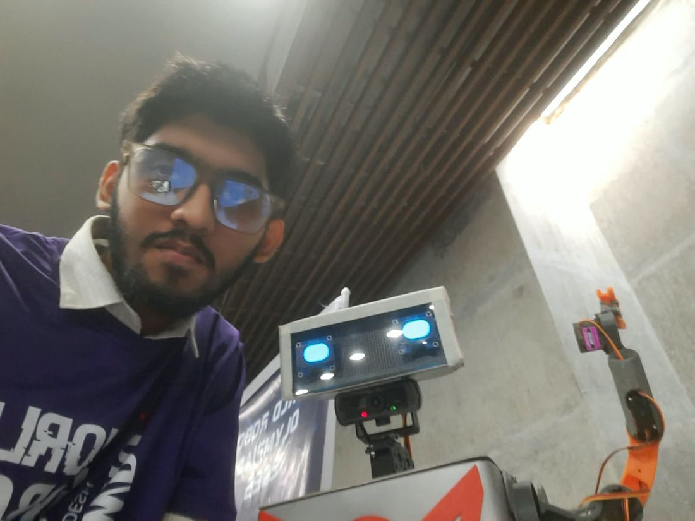

<!-- Header banner -->
<p align="center">
  
</p>

<p align="center">
  <a href="https://git.io/typing-svg">
    
  </a>
</p>

<p align="center">
  <a href="https://mdmahabub.com"></a>
  <a href="https://www.linkedin.com/in/mdmahabub-alam"></a>
  <a href="mailto:mahabub10mat@gmail.com"></a>
  
</p>

---

## 🤖 About me



I'm **Mahabub Alam**, a Computer Science & Engineering student at **Northern University Bangladesh** and a hands-on **robotics engineer** from Dhaka.

I like owning the whole stack: choosing sensors, wiring motor drivers, writing the firmware, 3D-printing the body and debugging on the bench until it works.

- 🦾 Competition robots — autonomous sumo, battle and soccer bots
- 🧠 Companion robots with animated faces and AI conversation
- 🏭 Real-world systems — a self-service print kiosk and a smart RFID toll plaza
- ⚡ AI automation with **n8n**, **Make.com** and LLM APIs
- 🎓 Robotics Bootcamp Organizer & Mentor at **NUBCC**, Senior Secretary (Robotics)
- 📫 Open to work — reach me at **mahabub10mat@gmail.com**

<br clear="right"/>

---

## 🛠️ Tech stack

**Languages**


**Hardware & Platforms**


**Protocols & Interfaces**


**Modules:** PCA9685 PWM driver · PCA9548A I²C mux · OLED (SH1106/SSD1306) · RFID RC522 · SIM800L · ESP32-CAM · HC-SR04 · TCRT5000 · TB6612FNG · BMI160

**AI & Automation**


**Tools**


---

## 🚀 Featured projects

| | Project | What it is | Built with |
|:-:|---|---|---|
|  | **[Robot Chotu](https://github.com/K-Mahabub/robot-chotu)** | Semi-humanoid companion robot with animated OLED eyes, servo arms and an AI brain | Servo · OLED · Python · n8n |
|  | **[NUB PrintBot](https://github.com/K-Mahabub/nub-printbot)** | Self-service printing kiosk: upload, pay with bKash, enter a code — it prints | Raspberry Pi · Python · PHP · MySQL |
|  | **[Autonomous Sumo Bot](https://github.com/K-Mahabub/autonomous-sumo-bot)** | Fully autonomous mini-sumo robot + a Python simulator to tune it | Arduino Nano · C++ · Pygame |
|  | **[Phone Bot](https://github.com/K-Mahabub/phone-bot)** | Turns an Android phone into a talking robot face (English + Bangla) | Kotlin · Jetpack Compose · ESP32 BLE |
|  | **[Smart Toll Plaza](https://github.com/K-Mahabub/smart-toll-plaza)** | RFID toll gate with balance deduction, servo barrier and ESP32-CAM | Arduino · RC522 · EEPROM |
|  | **[Desk Buddy](https://github.com/K-Mahabub/desk-buddy)** | Tiny ESP32 desktop robot with animated eyes, clock and its own TTS server | ESP32 · OLED · Flask |

<details>
<summary><b>More robots 👇</b></summary>
<br/>

| Project | What it is |
|---|---|
| **[Robo Soccer Bot](https://github.com/K-Mahabub/robo-soccer-bot)** | RC soccer robot with its own interrupt-based PPM decoder and motor mixing |
| **[Battle Bot “Zulfiqar”](https://github.com/K-Mahabub/battle-bot-zulfiqar)** | Armoured remote-controlled combat robot |
| **[Line Follower Robot](https://github.com/K-Mahabub/line-follower-robot)** | Line follower on a hand-soldered controller board |
| **[Rocket Prototype](https://github.com/K-Mahabub/rocket-prototype)** | 3D-printed rocket airframe experiment with a motor-driven propeller |

</details>

---

## 🔁 How I build

```text
  SENSE  ──►  DECIDE  ──►  ACT  ──►  ITERATE
   │            │           │           │
 Ultrasonic   Priority    Motor      Bench test,
 IR, RFID,    state       drivers,   serial debug,
 cameras      machines    servos,    reprint, rewire
                          PWM        — repeat until it wins
```

---

## 📊 GitHub stats

<p align="center">
  
  
</p>
<p align="center">
  
</p>

---

## 🏆 Certifications

- **AI Engineering Bootcamp** — Batch 6, Ostad (2026)
- **Master AI Automation & Build AI Agents (No Code)** — Batch 6, Ostad (2026) · **100% overall, top scorer**

---

<p align="center">
  <b>Have a robot in mind?</b> A competition bot, an embedded prototype or a robot that talks back — let's build it.<br/><br/>
  <a href="mailto:mahabub10mat@gmail.com"></a>
</p>

<p align="center">
  
</p>
